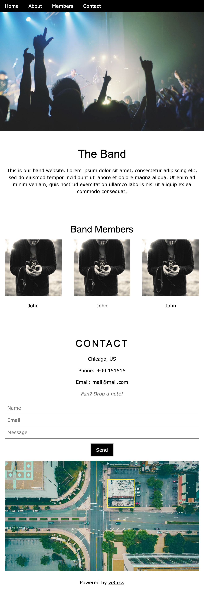

#Ricreazione di una pagina web – Progetto didattico

#Descrizione del progetto

#Realizzazione di una landing page di una sola pagina, basata sul modello presentato durante la lezione e sulle competenze acquisite.

##Antenrima del progetto

##Tecnologie utilizzate:

- HTML5
- CSS3

##Struttura della pagina:

- Header con menu di navigazione
- Banner principale 
- Sezione «About»
- Sezione «Members»
- Sezione «Contatti»

##Obiettivo del progetto

Ricreare la struttura e il layout di una pagina web utilizzando HTML e CSS, applicando i concetti studiati durante la lezione.

##Visualizzazione

Progetto sviluppato per la visualizzazione su schermi desktop (PC), senza implementazione del design responsive per dispositivi mobili.